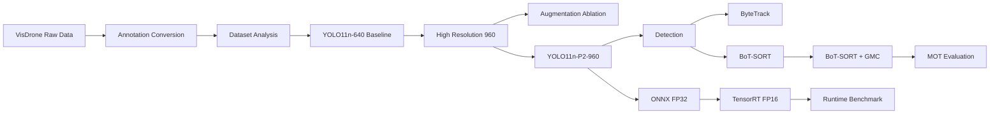

<div align="center">

# YOLO11-VisDrone

### UAV Small-Object Detection · Multi-Object Tracking · TensorRT Deployment

基于 **YOLO11 + VisDrone** 的无人机场景目标检测、跟踪与部署优化项目。  
围绕航拍场景中的 **小目标、密集目标、相机运动、ID Switch 与实时部署** 问题，完成从数据处理、检测模型消融、P2 小目标检测分支、多目标跟踪，到 ONNX / TensorRT 加速部署的完整工程闭环。

**`Python 3.10`** · **`PyTorch`** · **`YOLO11`** · **`VisDrone`** · **`ByteTrack`** · **`BoT-SORT`** · **`ONNX Runtime`** · **`TensorRT`**

</div>

---

## 📌 项目简介

VisDrone 航拍数据具有目标尺寸小、单帧目标密集、尺度变化明显以及无人机自身运动带来的全局画面变化等特点。直接使用通用目标检测与跟踪方案，容易出现：

- 小目标漏检、召回率偏低；
- 高空视角下车辆、行人等目标有效像素较少；
- 无人机旋转或快速运动时，轨迹关联不稳定；
- 目标短暂漏检后重新出现，容易产生新的 Track ID；
- PyTorch 推理满足功能验证，但仍有进一步部署加速空间。

本项目以 **YOLO11n** 为 Baseline，在 VisDrone 上完成一套可复现的实验路线：

1. 建立 YOLO11n-640 检测 Baseline；
2. 通过 `640 → 960` 高分辨率训练提升小目标表征能力；
3. 进行面向 VisDrone 的数据增强消融实验；
4. 在 YOLO11 Head 中增加 **P2/4 高分辨率检测分支**；
5. 对比 ByteTrack、BoT-SORT 以及 BoT-SORT + GMC；
6. 在完整 MOT-val 上统计 HOTA、IDF1、IDSW、MOTA 等指标；
7. 将最终模型导出为 ONNX FP32 与 TensorRT FP16；
8. 构建 PyTorch / ONNX Runtime / TensorRT 三后端统一 Benchmark。

---

## ✨ 项目亮点

| 模块 | Baseline / 对照 | 最终方案 | 核心结果 |
|---|---|---|---|
| 🎯 目标检测 | YOLO11n-640 | **YOLO11n-P2-960** | mAP50-95 **18.70% → 25.89%**；Recall **34.20% → 43.51%** |
| 🚁 多目标跟踪 | ByteTrack | **BoT-SORT + GMC** | HOTA **39.32 → 45.50**；IDF1 **46.72 → 56.07** |
| 🔗 身份保持 | BoT-SORT without GMC | **BoT-SORT + GMC** | IDSW **2202 → 1312**，下降约 **40.42%** |
| ⚡ 部署优化 | PyTorch FP32 | **TensorRT FP16** | Mean Latency **8.457 → 0.966 ms**，约 **8.75×** 推理加速 |
| 🚀 端到端性能 | PyTorch | **TensorRT FP16** | E2E FPS **86.68 → 237.21** |

> 最终方案：**YOLO11n-P2-960 + BoT-SORT + sparseOptFlow GMC + TensorRT FP16**

---

## 🧭 系统流程



---

## 🗂️ 项目结构

```text
YOLO11/
├── README.md
├── requirements.txt
│
├── configs/
│   ├── visdrone.yaml
│   ├── yolo11n_p2.yaml
│   ├── botsort_visdrone_no_gmc.yaml
│   └── botsort_visdrone_gmc.yaml
│
├── weights/
│   ├── yolo11n.pt
│   ├── best.pt
│   ├── best.onnx
│   └── best.engine
│
├── datasets/
│   ├── VisDrone/
│   │   ├── train/
│   │   │   ├── images/
│   │   │   ├── annotations/
│   │   │   └── labels/
│   │   ├── val/
│   │   │   ├── images/
│   │   │   ├── annotations/
│   │   │   └── labels/
│   │   └── test/
│   │       ├── images/
│   │       ├── annotations/
│   │       └── labels/
│   │
│   └── VisDrone2019-MOT-val/
│       ├── sequences/
│       └── annotations/
│
├── src/
│   ├── prepare_visdrone.py
│   ├── check_labels.py
│   ├── analyze_dataset.py
│   │
│   ├── train_baseline.py
│   ├── train_imgsz960.py
│   ├── train_aug.py
│   ├── check_p2_model.py
│   ├── train_p2.py
│   │
│   ├── detect_image.py
│   ├── detect_video.py
│   ├── convert_visdrone_video.py
│   ├── track_video.py
│   │
│   ├── evaluate_mot.py
│   ├── run_motval_all.py
│   ├── benchmark_runtime.py
│   └── export_onnx.py
│
├── outputs/
│   ├── dataset_analysis/
│   ├── train/
│   ├── motval_full/
│   ├── benchmark/
│   └── benchmark_runtime/
│
└── benchmark_runtime.py
```

> `weights/`、`datasets/` 与大体积 `outputs/` 建议通过 `.gitignore` 管理，不要直接把完整数据集、训练权重和 TensorRT Engine 提交到 Git 仓库。

---

## 📦 数据集

本项目主要使用：

### VisDrone2019-DET

用于目标检测训练与验证。

| Split | Images |
|---|---:|
| Train | 6,471 |
| Validation | 548 |
| Test-dev | 1,610 |

共包含 10 个检测类别：

```text
pedestrian
people
bicycle
car
van
truck
tricycle
awning-tricycle
bus
motor
```

原始 VisDrone 标注会在 `prepare_visdrone.py` 中转换为 Ultralytics YOLO 格式，并过滤 ignored region / 非训练类别。

### VisDrone2019-MOT-val

用于多目标跟踪与身份一致性评估。

本项目完整 MOT-val 实验覆盖：

```text
7 sequences
2846 frames
112,915 GT instances
```

---

## 🔄 数据预处理

运行：

```bash
python src/prepare_visdrone.py
```

转换完成后，YOLO 标签格式为：

```text
class_id x_center y_center width height
```

其中坐标均归一化到 `[0, 1]`。

建议在正式训练前先检查标签：

```bash
python src/check_labels.py
```

并进行数据集统计：

```bash
python src/analyze_dataset.py
```

---

## 🧠 检测模型优化

### 1. Baseline：YOLO11n-640

建立基础检测性能：

```text
Model   : YOLO11n
Input   : 640
Epochs  : 100
Dataset : VisDrone2019-DET
```

运行：

```bash
python src/train_baseline.py
```

---

### 2. High-Resolution：YOLO11n-960

VisDrone 中大量目标在原始图像中尺寸较小，因此将输入尺寸从 `640` 提升至 `960`，保留更多小目标空间信息。

```bash
python src/train_imgsz960.py
```

该实验是整个检测优化中收益最大的单项改动。

---

### 3. Data Augmentation Ablation

在保持 `imgsz=960` 的基础上，对面向航拍场景的数据增强策略进行消融：

```bash
python src/train_aug.py
```

实验结果表明，更强的数据增强并未继续提高总体 AP，因此最终方案没有简单堆叠增强策略，而是转向结构层面的 P2 优化。

---

### 4. YOLO11n-P2-960

原始 YOLO11 检测 Head 使用：

```text
P3/8
P4/16
P5/32
```

本项目进一步融合 Backbone 中已有的高分辨率 P2 特征，在 Head 中新增：

```text
P2/4
P3/8
P4/16
P5/32
```

使更高分辨率的浅层特征参与检测，以增强对航拍小目标的响应。

结构示意：

```text
Backbone P2
    │
    ├──────────────┐
    │              │
    ▼              │
P3 feature ── Upsample
    │              │
    └──── Concat ──┘
            │
            ▼
          P2/4
            │
            ├──────────────→ Detect
            ▼
          P3/8 ────────────→ Detect
            ▼
          P4/16 ───────────→ Detect
            ▼
          P5/32 ───────────→ Detect
```

先进行模型结构检查：

```bash
python src/check_p2_model.py
```

再正式训练：

```bash
python src/train_p2.py
```

---

## 📊 检测消融实验

| ID | Model / Strategy | Input | Precision ↑ | Recall ↑ | mAP50 ↑ | mAP50-95 ↑ |
|---|---|---:|---:|---:|---:|---:|
| E0 | YOLO11n Baseline | 640 | 0.4640 | 0.3420 | 0.3340 | 0.1870 |
| E1 | YOLO11n High-Resolution | 960 | **0.5520** | 0.4150 | 0.4300 | 0.2520 |
| E2 | YOLO11n-960 + Augmentation | 960 | 0.5370 | 0.4180 | 0.4290 | 0.2430 |
| **E3** | **YOLO11n-P2-960** | **960** | 0.5387 | **0.4351** | **0.4399** | **0.2589** |

从 E0 到 E3：

- `mAP50-95`：**18.70% → 25.89%**
- 绝对提升：**+7.19 percentage points**
- 相对提升：约 **38.45%**
- Recall：**34.20% → 43.51%**
- Recall 绝对提升：**+9.31 percentage points**

这表明，高分辨率输入是主要增益来源，而 P2 高分辨率检测分支在此基础上继续提高了 Recall 与总体 AP。

---

## 🎥 图像 / 视频推理

### Image

```bash
python src/detect_image.py
```

### Video

```bash
python src/detect_video.py
```

推荐推理配置：

```text
model   = weights/best.pt
imgsz   = 960
conf    = 0.25
max_det = 1000
device  = 0
```

`best.pt` 对应最终的 **YOLO11n-P2-960** 检测模型。

---

## 🚁 多目标跟踪

本项目保持检测器不变，仅改变 Tracker，以避免检测差异干扰跟踪消融结果。

### ByteTrack

```bash
python src/track_video.py \
    --model weights/best.pt \
    --source path/to/video.mp4 \
    --tracker bytetrack.yaml \
    --imgsz 960 \
    --conf 0.25 \
    --device 0
```

### BoT-SORT + GMC

```bash
python src/track_video.py \
    --model weights/best.pt \
    --source path/to/video.mp4 \
    --tracker configs/botsort_visdrone_gmc.yaml \
    --imgsz 960 \
    --conf 0.25 \
    --device 0
```

在无人机旋转、平移等 moving-camera 场景中，GMC 用于估计相邻帧的全局画面运动，从而减少由相机自身运动造成的错误轨迹关联。

---

## 📈 MOT 跟踪评估

在完整 VisDrone2019-MOT-val 上统一对比：

```bash
python src/run_motval_all.py \
    --trackers bytetrack botsort_no_gmc botsort_gmc \
    --device 0 \
    --overwrite
```

### Full MOT-val Results

| Tracker | GMC | HOTA ↑ | DetA ↑ | AssA ↑ | IDF1 ↑ | MOTA ↑ | Recall ↑ | Precision ↑ | IDSW ↓ | Frag ↓ |
|---|:---:|---:|---:|---:|---:|---:|---:|---:|---:|---:|
| ByteTrack | ✗ | 39.32 | 36.23 | 44.92 | 46.72 | 27.51 | 58.42 | 66.89 | 2253 | 3266 |
| BoT-SORT | ✗ | 40.19 | 36.49 | 46.63 | 47.63 | 27.94 | 58.82 | **67.03** | 2202 | **3185** |
| **BoT-SORT** | **✓** | **45.50** | **37.98** | **56.82** | **56.07** | **28.16** | **63.17** | 65.11 | **1312** | 3329 |

### GMC Ablation

对比 `BoT-SORT without GMC → BoT-SORT + GMC`：

| Metric | No GMC | + GMC | Change |
|---|---:|---:|---:|
| HOTA | 40.19 | **45.50** | **+5.31** |
| AssA | 46.63 | **56.82** | **+10.19** |
| IDF1 | 47.63 | **56.07** | **+8.44** |
| IDSW | 2202 | **1312** | **-890 / -40.42%** |
| Recall | 58.82 | **63.17** | **+4.35** |

结果说明，在移动无人机视角下，引入全局运动补偿能够明显改善关联质量和身份保持能力。

---

## ⏱️ Detection + Tracking Pipeline Benchmark

该实验衡量整条检测 / 跟踪 Pipeline 的实际 wall-clock 开销：

| Pipeline | Mean Latency ↓ | FPS ↑ |
|---|---:|---:|
| Detection Only | **38.92 ms** | **25.69** |
| Detection + ByteTrack | 49.17 ms | 20.34 |
| Detection + BoT-SORT | 48.16 ms | 20.77 |
| Detection + BoT-SORT + GMC | 90.50 ms | 11.05 |

GMC 能够显著改善跟踪质量，但也引入额外计算开销，体现了精度与实时性的工程权衡。

---

## 📤 ONNX / TensorRT 部署

### Export ONNX

```bash
python src/export_onnx.py
```

最终模型：

```text
weights/best.pt
        ↓
weights/best.onnx
        ↓
weights/best.engine
```

部署阶段统一使用：

```text
Input Size : 960
Batch      : 1
Max Det    : 1000
```

TensorRT 使用 FP16 精度。

---

## ✅ 部署精度一致性

最终模型在统一验证条件下：

| Backend | Precision ↑ | Recall ↑ | mAP50 ↑ | mAP50-95 ↑ | Precision Type |
|---|---:|---:|---:|---:|---|
| PyTorch | ≈0.544 | ≈0.428 | ≈0.444 | ≈0.263 | FP32 |
| ONNX Runtime | ≈0.538 | ≈0.438 | ≈0.444 | ≈0.263 | FP32 |
| TensorRT | ≈0.539 | ≈0.438 | ≈0.444 | ≈0.263 | FP16 |

ONNX FP32 与 TensorRT FP16 均基本保持 PyTorch 模型的检测精度，没有出现明显部署精度退化。

> 注意：这里是部署阶段在统一条件下重新验证的结果，因此与训练结束时 E3 的日志存在少量数值差异。两组结果应分别用于“训练消融”和“部署一致性”分析，不应交叉混用。

---

## ⚡ PyTorch / ONNX / TensorRT Benchmark

统一测试条件：

```text
GPU        : NVIDIA GeForce RTX 4090
Input Size : 960
Batch      : 1
Warmup     : 30
Images     : 300
Max Det    : 1000
```

| Backend | Precision | Mean Latency ↓ | P50 ↓ | P95 ↓ | Inference FPS ↑ | E2E FPS ↑ | Speedup |
|---|---|---:|---:|---:|---:|---:|---:|
| PyTorch | FP32 | 8.457 ms | 8.374 ms | 9.114 ms | 118.24 | 86.68 | 1.00× |
| ONNX Runtime CUDA | FP32 | 4.049 ms | 3.973 ms | 4.376 ms | 246.98 | 133.51 | ≈2.09× |
| **TensorRT** | **FP16** | **0.966 ms** | **0.966 ms** | **0.982 ms** | **1035.68** | **237.21** | **≈8.75×** |

相较 PyTorch FP32：

- ONNX Runtime 平均推理延迟降低约 **52.12%**；
- TensorRT FP16 平均推理延迟降低约 **88.58%**；
- TensorRT 纯模型推理约 **8.75×** 加速；
- TensorRT 端到端吞吐达到 **237.21 FPS**。

> `Inference FPS` 仅统计模型推理；`E2E FPS` 还包含预处理、后处理与数据搬运等开销，因此真实工程部署更应关注 E2E 指标。

---

## 🖥️ 实验环境

主要实验环境：

```text
OS          : Linux
Python      : 3.10
PyTorch     : 2.6.0 + CUDA 12.4
Ultralytics : 8.4.x
GPU         : NVIDIA GeForce RTX 4090 24GB
TensorRT    : 10.7
```

推荐创建独立环境：

```bash
conda create -n y11 python=3.10
conda activate y11

pip install ultralytics
pip install opencv-python matplotlib pandas tqdm pyyaml pillow scipy
```

ONNX / TensorRT 部署环境请根据本机 CUDA、驱动与 TensorRT 版本单独配置。

---

## 🚀 Quick Start

### 1. Clone

```bash
git clone <YOUR_REPOSITORY>
cd YOLO11
```

### 2. Prepare Dataset

将 VisDrone2019-DET 放到：

```text
datasets/VisDrone/
```

执行：

```bash
python src/prepare_visdrone.py
python src/check_labels.py
python src/analyze_dataset.py
```

### 3. Train Baseline

```bash
python src/train_baseline.py
```

### 4. Train Final P2 Model

```bash
python src/check_p2_model.py
python src/train_p2.py
```

### 5. Run Tracking

```bash
python src/track_video.py \
    --source path/to/video.mp4 \
    --tracker configs/botsort_visdrone_gmc.yaml
```

### 6. Evaluate Full MOT-val

```bash
python src/run_motval_all.py \
    --trackers bytetrack botsort_no_gmc botsort_gmc \
    --device 0 \
    --overwrite
```

### 7. Deployment Benchmark

```bash
python benchmark_runtime.py \
    --images datasets/VisDrone/val/images \
    --pt weights/best.pt \
    --onnx weights/best.onnx \
    --engine weights/best.engine \
    --imgsz 960 \
    --warmup 30 \
    --runs 300 \
    --device 0
```

---

## 🔬 实验结论

本项目的优化不是简单叠加模块，而是按照“问题分析 → 控制变量实验 → 结构优化 → 跟踪评估 → 部署验证”的方式逐步推进。

### Detection

高分辨率输入是 VisDrone 小目标检测的主要收益来源；在此基础上增加 P2/4 检测分支后，最终模型达到：

```text
mAP50-95 : 18.70% → 25.89%
Recall   : 34.20% → 43.51%
```

### Tracking

无人机旋转和平移会造成显著的全局画面运动。BoT-SORT 引入 sparseOptFlow GMC 后：

```text
HOTA : 40.19 → 45.50
IDF1 : 47.63 → 56.07
IDSW : 2202  → 1312
```

说明全局运动补偿对 moving-camera 场景中的身份保持具有明显作用。

### Deployment

TensorRT FP16 在基本保持检测精度的同时，将平均模型推理延迟从：

```text
8.457 ms → 0.966 ms
```

并将端到端吞吐提升至：

```text
237.21 FPS
```

最终形成一条完整的无人机视觉感知工程链路：

```text
VisDrone
   ↓
Data Processing
   ↓
YOLO11n-P2-960
   ↓
BoT-SORT + GMC
   ↓
MOT Evaluation
   ↓
ONNX
   ↓
TensorRT FP16
   ↓
Real-time Deployment Benchmark
```

---

## 📌 Reproducibility Notes

为保证实验可复现，建议遵循以下原则：

- 检测消融实验使用相同数据划分与训练轮数；
- E1 / E2 / E3 均从相同的 YOLO11n 预训练权重开始；
- E3 仅以 P2 结构作为主要变量，不与 E2 强增强同时叠加；
- MOT 对比固定同一个检测器、输入尺寸、置信度阈值和最大检测数；
- 每个 MOT sequence 重新初始化 Tracker，避免跨视频状态泄漏；
- 部署 Benchmark 固定 GPU、输入尺寸、Batch、Warmup 和测试样本数量；
- `Inference FPS` 与 `E2E FPS` 分开报告；
- 训练阶段指标与部署阶段重新验证指标分别记录，避免不同实验口径混用。

---

## 🧩 后续可以继续扩展

- [ ] TensorRT INT8 量化与精度 / 延迟对比
- [ ] BoT-SORT ReID 消融实验
- [ ] 不同无人机运动强度下的 GMC 鲁棒性分析
- [ ] 按 Small / Medium / Large 尺度统计 AP
- [ ] 增加 Demo GIF / 视频与失败案例可视化
- [ ] 封装实时摄像头 / RTSP 推理接口

---

## 🙏 Acknowledgements

本项目基于以下开源工作与公开数据集完成：

- **Ultralytics YOLO11**：目标检测、跟踪与模型导出框架；
- **VisDrone**：无人机目标检测与多目标跟踪数据集；
- **ByteTrack**：多目标跟踪 Baseline；
- **BoT-SORT**：融合运动、外观与相机运动补偿的多目标跟踪方法；
- **ONNX Runtime / NVIDIA TensorRT**：模型部署与 GPU 推理加速。

感谢上述开源社区与研究工作的贡献。

---

## 📄 License

本仓库中的自编写实验代码用于学习、研究与技术交流。

项目依赖的 Ultralytics、VisDrone、ONNX Runtime、TensorRT 及其他第三方组件均遵循其各自的许可证与使用条款。  
如果仓库中包含或修改了第三方源码，请根据对应上游许可证保留必要的版权和许可证声明。

---

<div align="center">

### ⭐ If this project is useful to you, feel free to star it.

**YOLO11-VisDrone — Detection · Tracking · Deployment**

</div>
