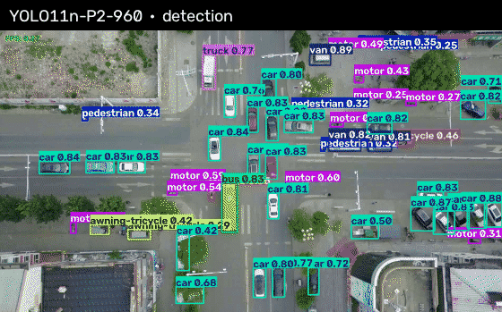
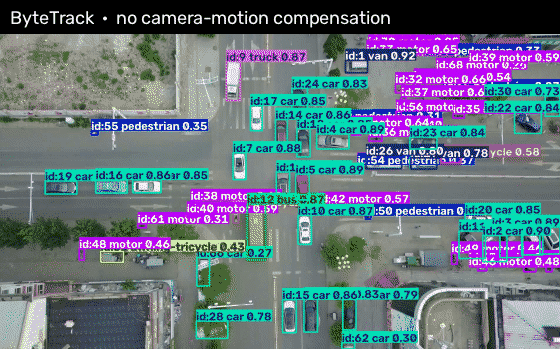
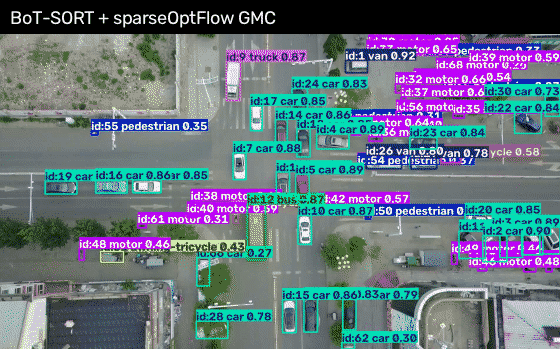
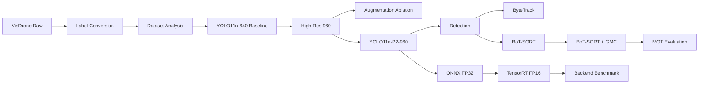

<div align="center">

# YOLO11-VisDrone

### UAV Small-Object Detection · Multi-Object Tracking · TensorRT Deployment

基于 **YOLO11 + VisDrone** 的无人机场景小目标检测、跟踪与部署优化项目  
从数据预处理、检测消融、P2 小目标分支、多目标跟踪，到 ONNX / TensorRT 加速的完整工程闭环


</div>

---

## 🎬 Demo

同一段无人机旋转序列（`uav0000305_00000_v`，184 帧），检测器固定为 **YOLO11n-P2-960**，只改变跟踪器：

| Detection only | ByteTrack | **BoT-SORT + GMC** |
|:--:|:--:|:--:|
|  |  |  |
| 只画框，无 ID | 相机旋转时 ID 频繁跳变 | 全局运动补偿后 ID 明显稳定 |

---

## ✨ 核心结果

| 模块 | 基线 | 最终方案 | 结果 |
|---|---|---|---|
| 🎯 检测 | YOLO11n-640 | **YOLO11n-P2-960** | mAP50-95 **18.79% → 26.30%**（+7.51 pp）；Recall **34.34% → 42.86%** |
| 🚁 跟踪 | ByteTrack | **BoT-SORT + sparseOptFlow GMC** | HOTA **39.32 → 45.50**；IDF1 **46.72 → 56.07** |
| 🔗 身份保持 | BoT-SORT 无 GMC | **BoT-SORT + GMC** | IDSW **2202 → 1312（−40.42%）**；AssA **46.63 → 56.82** |
| ⚡ 部署 | PyTorch FP32 | **TensorRT FP16** | 平均推理延迟 **8.457 → 0.966 ms（−88.58%，8.76×）**；端到端 **86.68 → 237.21 FPS** |

> 最终方案：**YOLO11n-P2-960 + BoT-SORT + sparseOptFlow GMC + TensorRT FP16**

---

## 📌 项目解决什么问题

VisDrone 航拍数据有三个特点，正好对应三类失败模式：

| 现象 | 原因 | 本项目做法 |
|---|---|---|
| 小目标漏检、召回低 | 目标只占几十像素，多次下采样后特征被稀释 | 输入 640 → **960**；在 Head 增加 **P2/4** 高分辨率检测分支 |
| 相机旋转时 ID 频繁跳变 | 无人机自身运动造成全局画面位移，运动模型失效 | BoT-SORT 引入 **sparseOptFlow GMC** 做全局运动补偿 |
| 精度够了但端到端跑不快 | PyTorch FP32 推理开销大，Python 前后处理也有固定成本 | **ONNX → TensorRT FP16**，并拆分 pre / infer / post 分别计时 |

优化顺序是 **问题分析 → 控制变量实验 → 结构改动 → 跟踪评估 → 部署验证**，而不是堆模块。

---

## 🧭 系统流程



---

## 🗂️ 项目结构

```text
YOLO11-VisDrone/
├── assets/                     # README demo GIF
├── configs/
│   ├── visdrone.yaml           # 检测数据配置（相对路径）
│   ├── yolo11n_p2.yaml         # 增加 P2/4 检测头的模型结构
│   ├── botsort_visdrone_no_gmc.yaml
│   └── botsort_visdrone_gmc.yaml
├── src/
│   ├── prepare_visdrone.py     # DET 标注 → YOLO 格式
│   ├── check_labels.py
│   ├── analyze_dataset.py
│   ├── train_baseline.py       # E0
│   ├── train_imgsz960.py       # E1
│   ├── train_aug.py            # E2
│   ├── check_p2_model.py       # 打印 P2 结构 / strides
│   ├── inspect_p2.py
│   ├── train_p2_sanity.py      # 1 epoch 冒烟
│   ├── train_p2.py             # E3
│   ├── detect_image.py
│   ├── detect_video.py
│   ├── convert_visdrone_video.py
│   ├── track_video.py          # 单视频跟踪 + 可视化
│   ├── track_video_mot.py      # 单序列跟踪 + MOT txt
│   ├── evaluate_mot.py         # 自研 HOTA / CLEAR / Identity
│   ├── run_motval_all.py       # 7 序列全量评测
│   ├── benchmark_backends.py   # PyTorch / ONNX / TensorRT
│   ├── benchmark_pipeline.py   # detect / det+track 流水线开销
│   ├── export_onnx.py
│   └── make_gifs.py
├── weights/                    # 不入库
├── datasets/                   # 不入库
└── outputs/                    # 不入库
```

---

## 📦 数据准备

### VisDrone2019-DET

| Split | Images |
|---|---:|
| Train | 6,471 |
| Validation | 548 |
| Test-dev | 1,610 |

10 类：`pedestrian / people / bicycle / car / van / truck / tricycle / awning-tricycle / bus / motor`。

### VisDrone2019-MOT-val

7 个序列、**2,846 帧**、**112,915** 个 GT 实例，用于跟踪与身份一致性评估。

### 放置方式

```text
datasets/
├── VisDrone/
│   ├── train/{images,labels}
│   ├── val/{images,labels}
│   └── test/{images,labels}
└── VisDrone2019-MOT-val/
    ├── sequences/
    └── annotations/
```

`configs/visdrone.yaml` 中写的是相对路径 `datasets/VisDrone`，**请在仓库根目录执行脚本**。  
若数据集放在别处，二选一：

```bash
# 方案 A：软链接到仓库内
ln -s /your/path/VisDrone datasets/VisDrone

# 方案 B：改 Ultralytics 的全局数据集目录
yolo settings datasets_dir=/your/path/to/datasets
```

转换与检查：

```bash
python src/prepare_visdrone.py    # 过滤 ignored region / 非训练类别
python src/check_labels.py
python src/analyze_dataset.py     # 尺寸 / 密度 / 类别分布统计
```

---

## 🧠 检测：从 640 到 P2-960

| 实验 | 改动 |
|---|---|
| **E0** | YOLO11n，`imgsz=640`，标准 P3/P4/P5 检测头 |
| **E1** | 仅把输入提升到 `imgsz=960` |
| **E2** | 在 E1 基础上加航拍向数据增强（`degrees=5`、`scale=0.7`） |
| **E3** | 回到 E1 的增强配置，改为在 Head 增加 **P2/4** 检测分支 |

```bash
python src/train_baseline.py
python src/train_imgsz960.py
python src/train_aug.py
python src/check_p2_model.py
python src/train_p2.py
```

### P2 分支做了什么

原始 YOLO11 只把 P3/8、P4/16、P5/32 送进 Detect。本项目把 Backbone 中已有的 **P2/4** 特征经上采样与 Concat 后一并送入检测头：

```text
Backbone P2 ──┐
              ├─ Upsample ── Concat ── C3k2 ──► Detect (P2/4)
P3 feature ───┘                              ├─► Detect (P3/8)
                                             ├─► Detect (P4/16)
                                             └─► Detect (P5/32)
```

`configs/yolo11n_p2.yaml` 在官方结构上新增 17–19 号层，并把 `Detect` 的输入改为 `[19, 22, 25, 28]`。

### 消融结果

统一条件：各自 `best.pt`、VisDrone val 548 张 / 38,759 实例、`max_det=1000`、RTX 4090。

| ID | 模型 | Input | Precision | Recall | mAP50 | mAP50-95 |
|---|---|---:|---:|---:|---:|---:|
| E0 | YOLO11n | 640 | 0.4655 | 0.3434 | 0.3354 | 0.1879 |
| E1 | YOLO11n | 960 | **0.5535** | 0.4156 | 0.4312 | 0.2526 |
| E2 | YOLO11n-960 + Aug | 960 | 0.5375 | 0.4185 | 0.4297 | 0.2436 |
| **E3** | **YOLO11n-P2-960** | **960** | 0.5422 | **0.4286** | **0.4439** | **0.2630** |

- **E0 → E3**：mAP50-95 **+7.51 pp**（相对 +40.0%），Recall **+8.52 pp**
- **E1 → E3**：P2 分支带来 mAP50-95 **+1.04 pp**、Recall **+1.30 pp**
- **E2 没有带来提升**：更强的增强反而略降，所以最终方案没有叠增强，而是转向结构改动

### P2 的代价

| 模型 | Params | GFLOPs @960 |
|---|---:|---:|
| YOLO11n | 2.624 M | 15.19 |
| YOLO11n-P2 | 2.660 M（+1.4%） | **25.97（+71%）** |

也就是说：**多 1.4% 参数、多 71% 计算量，换 1.04 个 mAP 点**。  
这也是后面必须做 TensorRT 的原因——结构上多花的算力，只能靠部署侧压回来。

---

## 🚁 多目标跟踪

检测器固定为 `weights/best.pt`，**只改 Tracker**，避免检测差异干扰跟踪对比。

三个配置的差异只有一项：是否启用 GMC。

```yaml
# configs/botsort_visdrone_gmc.yaml
tracker_type: botsort
track_high_thresh: 0.25
track_low_thresh: 0.10
new_track_thresh: 0.25
track_buffer: 30
match_thresh: 0.80
gmc_method: sparseOptFlow   # ← 唯一变量
with_reid: false
```

```bash
python src/track_video.py \
    --source path/to/video.mp4 \
    --tracker configs/botsort_visdrone_gmc.yaml \
    --imgsz 960 --conf 0.25
```

### 全量 MOT-val 结果

| Tracker | GMC | HOTA ↑ | DetA ↑ | AssA ↑ | IDF1 ↑ | MOTA ↑ | Recall ↑ | Precision ↑ | IDSW ↓ | Frag ↓ |
|---|:---:|---:|---:|---:|---:|---:|---:|---:|---:|---:|
| ByteTrack | ✗ | 39.32 | 36.23 | 44.92 | 46.72 | 27.51 | 58.42 | 66.89 | 2253 | 3266 |
| BoT-SORT | ✗ | 40.19 | 36.49 | 46.63 | 47.63 | 27.94 | 58.82 | **67.03** | 2202 | **3185** |
| **BoT-SORT** | **✓** | **45.50** | **37.98** | **56.82** | **56.07** | **28.16** | **63.17** | 65.11 | **1312** | 3329 |

### GMC 消融（同一检测器、同一 conf）

| Metric | 无 GMC | + GMC | Δ |
|---|---:|---:|---:|
| HOTA | 40.19 | **45.50** | **+5.31** |
| AssA | 46.63 | **56.82** | **+10.19** |
| IDF1 | 47.63 | **56.07** | **+8.44** |
| IDSW | 2202 | **1312** | **−890（−40.42%）** |
| Recall | 58.82 | **63.17** | **+4.35** |
| Precision | 67.03 | 65.11 | −1.92 |
| Frag | 3185 | 3329 | +144 |

**代价也要写清楚**：GMC 用召回和身份保持换了一点精确率，碎片数也略有上升。

### 逐序列结果（GMC 在 7/7 条序列上均为正）

| Sequence | HOTA ByteTrack | HOTA BoT-SORT+GMC | Δ | IDSW 变化 |
|---|---:|---:|---:|---:|
| uav0000086_00000_v | 40.94 | 42.89 | +1.95 | 359 → 330 |
| uav0000117_02622_v | 36.35 | 45.73 | **+9.37** | 515 → 198 |
| uav0000137_00458_v | 42.39 | 52.99 | **+10.60** | 817 → 364 |
| uav0000182_00000_v | 34.94 | 38.82 | +3.88 | 270 → 227 |
| uav0000268_05773_v | 32.85 | 33.14 | +0.29 | 12 → 12 |
| uav0000305_00000_v | 46.58 | 49.17 | +2.59 | 56 → 56 |
| uav0000339_00001_v | 38.78 | 49.65 | **+10.88** | 224 → 125 |

收益集中在旋转幅度大的三条序列（0117 / 0137 / 0339），与 GMC 的设计动机一致；在几乎不旋转的 0268 上增益接近于 0——这正好说明增益来源是相机运动，而不是别的因素。

---

## ⏱️ 检测 / 跟踪流水线开销

整条 pipeline 的 wall-clock 计时（同一序列，PyTorch 后端）：

| Pipeline | Mean Latency ↓ | FPS ↑ |
|---|---:|---:|
| Detection only | **38.92 ms** | **25.69** |
| Detection + ByteTrack | 49.17 ms | 20.34 |
| Detection + BoT-SORT | 48.16 ms | 20.77 |
| Detection + BoT-SORT + GMC | 90.50 ms | 11.05 |

GMC 独占约 **42 ms**，把 FPS 从 20.77 压到 11.05。  
这就是精度与实时性的真实 trade-off，也是下一步最值得优化的地方（见「局限」）。

---

## ⚡ 部署：ONNX → TensorRT FP16

```bash
python src/export_onnx.py                      # best.pt → best.onnx (FP32, batch=1, imgsz=960)
yolo export model=weights/best.onnx format=engine half=True imgsz=960 device=0
```

### 部署精度一致性

| Backend | Precision ↑ | Recall ↑ | mAP50 ↑ | mAP50-95 ↑ |
|---|---:|---:|---:|---:|
| PyTorch FP32 | ≈0.544 | ≈0.428 | ≈0.444 | ≈0.263 |
| ONNX Runtime FP32 | ≈0.538 | ≈0.438 | ≈0.444 | ≈0.263 |
| TensorRT FP16 | ≈0.539 | ≈0.438 | ≈0.444 | ≈0.263 |

**FP16 没有带来可观精度损失**，这是能上线的关键前提。

### 三后端 Benchmark

条件：RTX 4090 / `imgsz=960` / `batch=1` / warmup 30 / 300 张图 / `max_det=1000`。

| Backend | Mean ↓ | P50 ↓ | P95 ↓ | Inference FPS ↑ | E2E FPS ↑ | Speedup |
|---|---:|---:|---:|---:|---:|---:|
| PyTorch FP32 | 8.457 ms | 8.374 | 9.114 | 118.24 | 86.68 | 1.00× |
| ONNX Runtime CUDA | 4.049 ms | 3.973 | 4.376 | 246.98 | 133.51 | 2.09× |
| **TensorRT FP16** | **0.966 ms** | 0.966 | 0.982 | **1035.68** | **237.21** | **8.76×** |

```bash
python src/benchmark_backends.py \
    --pt weights/best.pt --onnx weights/best.onnx --engine weights/best.engine \
    --images datasets/VisDrone/val/images \
    --imgsz 960 --warmup 30 --num-images 300 --device 0
```

### 端到端时间都花在哪

| Backend | preprocess | inference | postprocess | E2E | 推理占比 |
|---|---:|---:|---:|---:|---:|
| PyTorch | 1.619 ms | 8.457 ms | 1.023 ms | 11.537 ms | 73.3% |
| ONNX RT | 1.948 ms | 4.049 ms | 1.076 ms | 7.490 ms | 54.1% |
| **TensorRT** | 1.876 ms | **0.966 ms** | 1.000 ms | **4.216 ms** | **22.9%** |

推理快了 8.76 倍，但端到端只快了 2.74 倍——因为 **TensorRT 下 68% 的时间已经不在推理上了**。  
这条结论直接决定了下一步该优化哪儿。

---

## 🖥️ 实验环境

```text
OS          : Linux
Python      : 3.10.21
PyTorch     : 2.6.0 + CUDA 12.4
Ultralytics : 8.4.160
GPU         : NVIDIA GeForce RTX 4090 24 GB
TensorRT    : 10.7.0
ONNX Runtime: 1.23.2 (CUDA)
```

```bash
conda create -n y11 python=3.10 -y
conda activate y11
pip install -r requirements.txt
# 部署环境按本机 CUDA / 驱动单独安装 tensorrt
```

---

## 🚀 Quick Start

```bash
git clone https://github.com/AIGPTtop/yolo11-visdrone.git
cd yolo11-visdrone
pip install -r requirements.txt
```

```bash
# 1. 数据
python src/prepare_visdrone.py && python src/check_labels.py

# 2. 训练（E0 → E3）
python src/train_baseline.py
python src/train_imgsz960.py
python src/train_aug.py
python src/train_p2.py

# 3. 跟踪
python src/track_video.py --source path/to/video.mp4 \
    --tracker configs/botsort_visdrone_gmc.yaml --imgsz 960 --conf 0.25

# 4. MOT 全量评测
python src/run_motval_all.py --trackers bytetrack botsort_no_gmc botsort_gmc \
    --conf 0.25 --output outputs/motval_full --overwrite

# 5. 部署 + benchmark
python src/export_onnx.py
python src/benchmark_backends.py --pt weights/best.pt --onnx weights/best.onnx \
    --engine weights/best.engine --images datasets/VisDrone/val/images \
    --imgsz 960 --warmup 30 --num-images 300
```

---

## 📌 复现说明

- 检测消融统一从同一个 `yolo11n.pt` 出发，`epochs=100`、`seed=0`、`deterministic=True`；
- **E0 用 `batch=16`、E1–E3 用 `batch=32`**（640 与 960 的显存对齐），未单独做 batch 敏感性实验；
- 表格中的检测指标来自对各自 `best.pt` 的**独立复验**，与训练日志末轮数值有 ±0.1~0.4 个点的差异（`max_det`、batch 不同所致）；
- 跟踪对比固定检测器、`imgsz=960`、`conf=0.25`、`max_det=1000`，每条序列重新初始化 Tracker；
- 部署指标与训练指标分别记录，不交叉引用；
- `Inference FPS` 只统计模型推理，`E2E FPS` 含前后处理与数据搬运。

---

## ⚠️ 已知局限（下一步）

| 局限 | 说明 | 计划 |
|---|---|---|
| **跟踪阈值** | 评测用 `conf=0.25`，而 `track_low_thresh=0.10`，低分框在检测端就被滤掉，ByteTrack 的二次关联未被充分利用 | 补 `conf=0.10` 消融，修正跨算法对比 |
| **GMC 开销** | GMC 独占约 42 ms，未做任何优化 | 半分辨率光流 / ORB / 隔帧估计，做 HOTA–延迟 Pareto |
| **前后处理瓶颈** | TensorRT 下端到端仍有 68% 花在 Python 前后处理 | GPU 预处理 + 融合 NMS，目标 E2E < 2 ms |
| **评估器未交叉验证** | `evaluate_mot.py` 为自研 HOTA / CLEAR / Identity 实现 | 与 TrackEval 对同一批 txt 结果做一致性校验 |
| **未做量化与小目标分桶** | 只有 FP16；没有 AP_s / AP_m / AP_l | INT8 校准 + 按尺度统计 AP |
| **跨后端跟踪未闭环** | TensorRT 只用于检测 benchmark，跟踪仍在 PyTorch 下测 | `YOLO("best.engine").track()` 打通实时跟踪链路 |

---

## 🙏 Acknowledgements

- **Ultralytics YOLO11**：检测、跟踪与模型导出框架
- **VisDrone**：无人机目标检测与多目标跟踪数据集
- **ByteTrack / BoT-SORT**：多目标跟踪方法
- **ONNX Runtime / NVIDIA TensorRT**：推理与加速

## 📄 License

MIT，见 [LICENSE](LICENSE)。Ultralytics 以 AGPL-3.0 分发，本项目仅作为依赖使用，未修改或再分发其源码；VisDrone 数据集遵循其自身条款，不随仓库分发。

<div align="center">

### ⭐ 如果这个项目对你有帮助，欢迎 star

**YOLO11-VisDrone — Detection · Tracking · Deployment**

</div>
